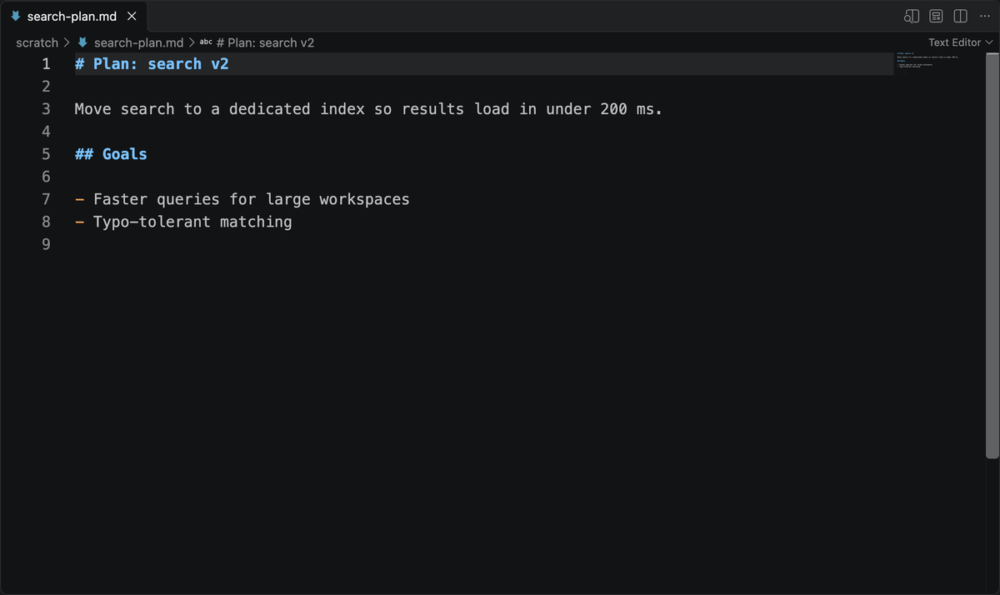
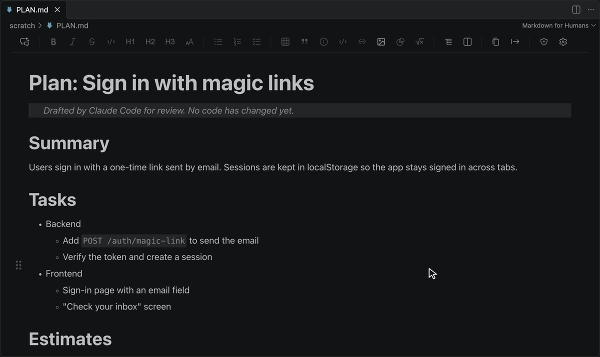
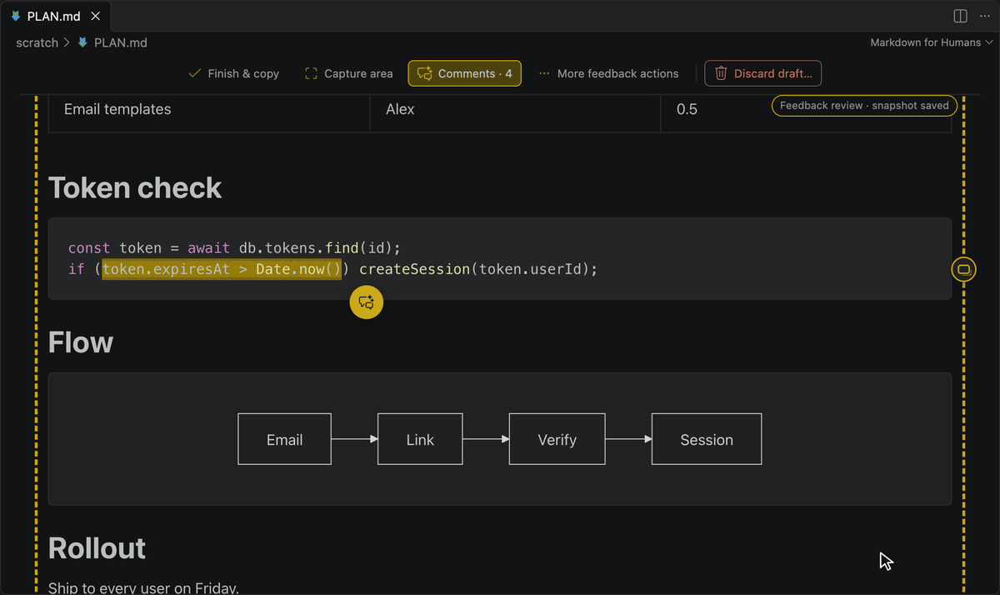
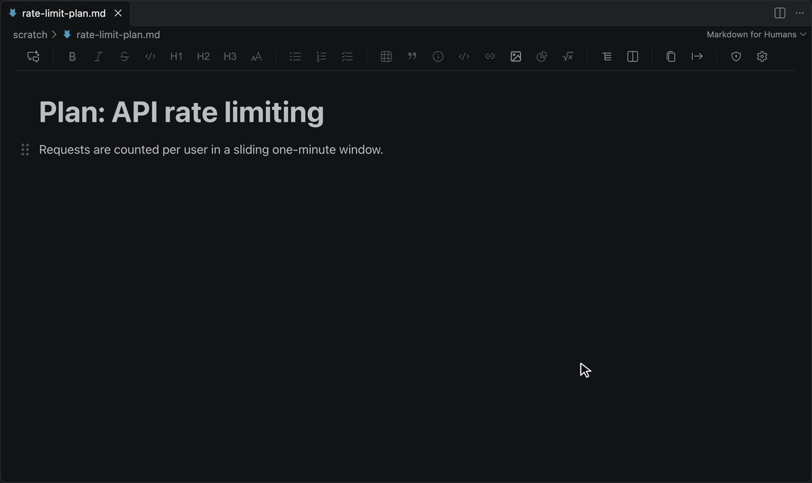
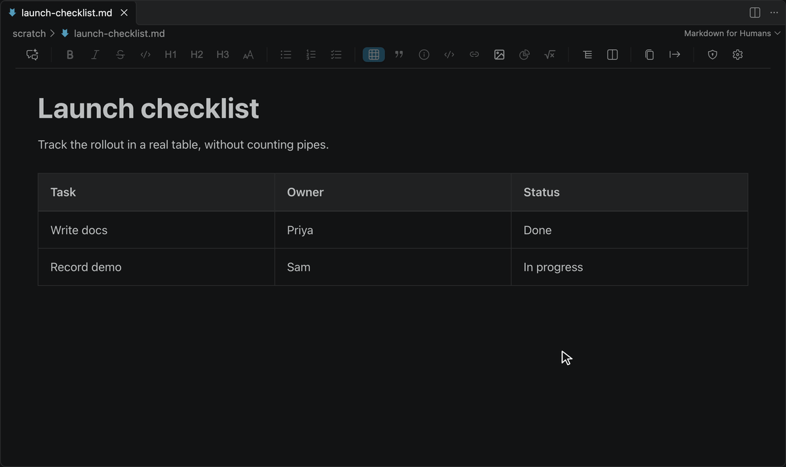
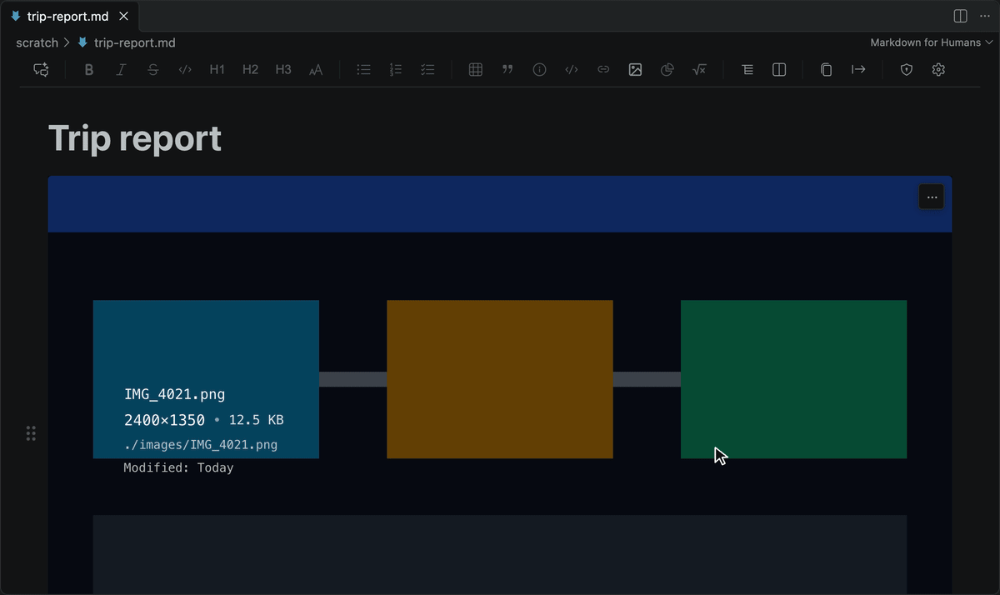
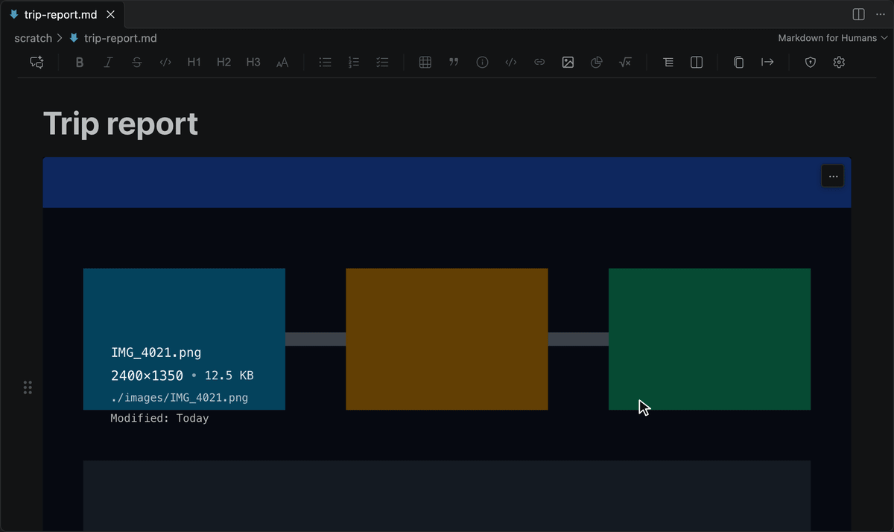
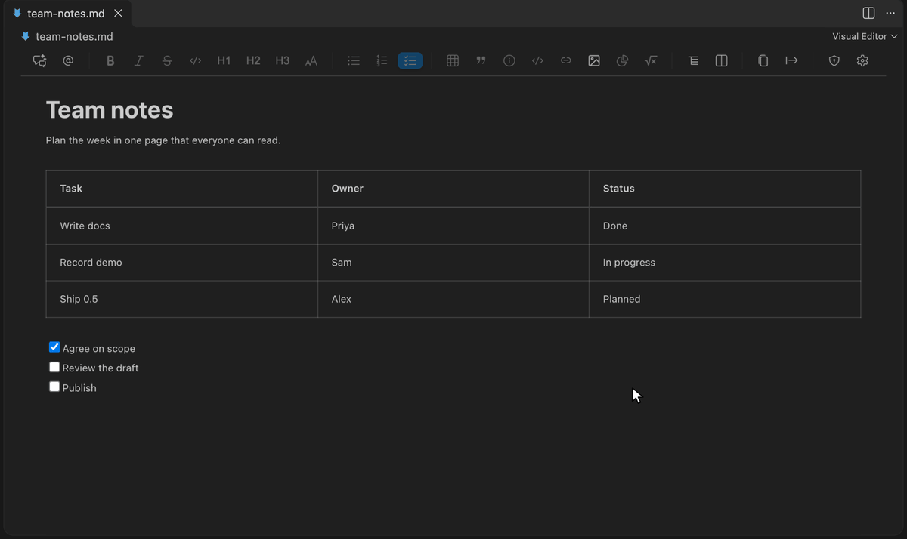
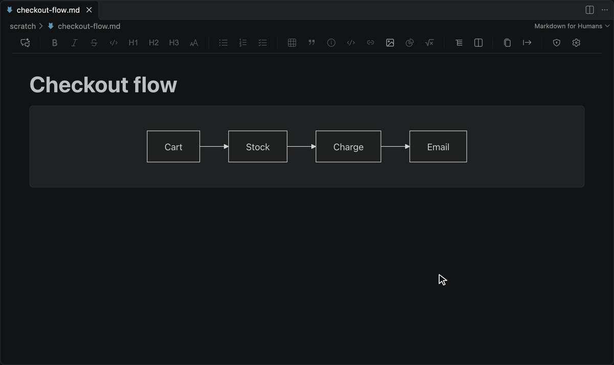
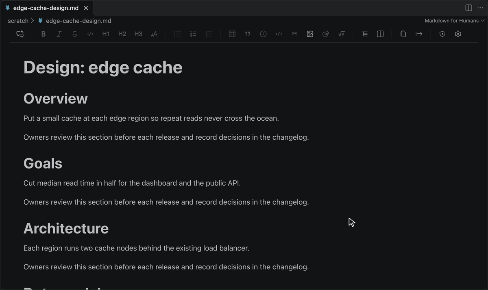

# Markdown Editor for Humans

**Edit Markdown like a document. Commit it like code.** A rich, readable Markdown editor inside VS Code, Cursor and Devin Desktop (formerly Windsurf) that keeps your file as plain Markdown.

**In six languages:** English, 简体中文, 日本語, Español, Português (Brasil) and Русский. See [Languages](#languages).

   

*Open any `.md` file, write in the rendered view, and use the Markdown shortcuts you already know: `##` for a heading, `[ ]` for a task, `Cmd/Ctrl+B` for bold.*

## Install

- **VS Code:** [Marketplace](https://marketplace.visualstudio.com/items?itemName=concretio.markdown-for-humans), or search `concretio.markdown-for-humans` in Extensions.
- **Cursor, Devin Desktop (formerly Windsurf), VSCodium and other Open VSX IDEs:** [Open VSX Registry](https://open-vsx.org/extension/concretio/markdown-for-humans), or search the same ID in Extensions.
- **Open a file:** right-click any `.md` file and choose **Open with Markdown Editor for Humans**. In **Open With...** it is listed as **Visual Editor**.

> **📌 100% free and open source (MIT). No account, no telemetry, no paywalls, ever.**

## Why Markdown Editor for Humans

- **Review what your AI agent wrote.** Comment on the rendered plan, then hand a sealed feedback file to Claude Code, Codex or any agent.
- **Tables and images without syntax.** Edit tables visually; resize and rename images from the editor.
- **Readable your way, in your language.** Set the font, spacing and zoom you read best in; the interface comes in six languages.
- **Your file stays your file.** Blocks you do not edit keep their exact source on save, so Git diffs show only what you changed. The editor warns you before an edit would remove HTML it cannot keep.
- **Opt-in, never a takeover.** It opens only when you choose it, and you can make it your default for `.md` files.

---

## Review AI-Written Markdown

Plans, specs and `CLAUDE.md` files are easier to review rendered. Start a review, comment on as many places as you need, then hand the whole set to your agent in one sealed file.

**Comment on anything in one pass:** selected text, a nested list item, a table row, or part of a code block. Hover a block for the comment button in the left rail; **Change scope** widens or narrows the target.

**Mark up a screenshot, see every comment in the side rail, then submit.** Capture an area when words are not enough, edit any saved comment from its card, and click **Finish & copy**.

1. Open a saved Markdown file in a workspace and click the first toolbar button, **Log feedback for an LLM**.
2. Add as many comments as you need: on text, blocks, list items, table cells, or captured areas.
3. Click **Finish & copy**. The bundle is sealed under `.md4h/feedback/` and a handoff prompt is on your clipboard.
4. Paste the prompt into Claude Code, Codex, or any workspace-aware agent.

The document is locked while you review, so your comments always point at the source the agent will read. [How the feedback file works →](docs/FEEDBACK.md)

**Just need to point at a spot?** Put the caret on a line or select a range, then click **@** (the second toolbar button, beside **Log feedback for an LLM**) or run **Markdown Editor for Humans: Copy Reference for AI**. A reference such as `@bom/README.md#L10-14` is on your clipboard, with the exact lines of the saved file: the row inside a table, the line inside a code block, the item inside a nested list.

**The view keeps up while your agent works.** When a terminal, an agent, or Git changes the file on disk, the rendered view updates in place.

---

## Tables Without Pipes

- **Tab** to the next cell; Tab in the last cell adds a row
- **Right-click** any cell to insert or delete rows and columns
- **Toolbar** controls for inserting and editing tables

*Stop counting pipes and dashes.*

---

## Images That Manage Themselves

- **Resize** to a new width from the image menu, with the original backed up under `.md4h/image-backups/`
- **Rename** an image from its menu: the file is renamed on disk and the Markdown link is updated
- **Size suggestions** for oversized images, to keep your repo small
- **Hover details:** dimensions, file size and path at a glance
- **Drag and drop or paste** images into the document

- **SVG:** local SVG files render as vectors and are never rewritten. **Image options > Display size** sets the width of one occurrence, saved as an HTML ``; unsized images stay ordinary Markdown. See [Known Issues](./KNOWN_ISSUES.md#svg-images) for SVG limits.

---

## Readable Your Way

A reader with ADHD asked for font options ([issue 86](https://github.com/concretios/markdown-for-humans/issues/86)), so we built them. Set the text to what you read best in:

- **Font:** any font installed on your computer, for body text and headings
- **Weight and spacing:** font weight, line height, letter spacing and word spacing
- **Size:** zoom the whole editor from 50% to 200%
- **Or match your code editor:** one setting uses your VS Code editor font, including `"[markdown]"` overrides

Changes apply at once to every open editor. Code blocks stay monospace, and math and diagrams keep their own fonts. No special font ships with the editor; you pick one you have installed. Line height, letter spacing and word spacing are the settings that dyslexia style guides give recommendations for. All of it is under `markdownForHumans.font.*` and `markdownForHumans.zoom` in [Configuration](#configuration).

---

## Languages

Use the editor in your own language: 简体中文, 日本語, Español, Português do Brasil, Русский or English.

The editor follows your VS Code display language. Menus, dialogs, messages, command names and settings are available in:

| Language | Display language to pick |
| -------- | ------------------------ |
| English | English |
| 简体中文 (Chinese, Simplified) | 中文(简体) |
| 日本語 (Japanese) | 日本語 |
| Español (Spanish) | Español |
| Português do Brasil (Portuguese, Brazil) | Português (Brasil) |
| Русский (Russian) | Русский |

- **Switch language:** run **Configure Display Language** from the Command Palette and pick one. VS Code installs that language's Language Pack if you do not have it, then asks to restart. Any other display language shows English, and so does a language whose Language Pack is not installed.
- **Word count** counts Chinese and Japanese text by character, the way word processors do.
- **Help us get it right.** These translations were drafted and cross-checked by AI against VS Code's own wording, and no native speaker has reviewed them yet. If something reads wrong, or you want another language, see [Translations](./l10n/README.md) or [open an issue](https://github.com/concretios/markdown-for-humans/issues).

---

## Diagrams, Math, Alerts and Code

- **Mermaid diagrams:** edit the source beside the rendered view and the diagram updates as you type; 15 templates; double-click a diagram to edit its source in a dialog
- **Math:** LaTeX equations rendered with KaTeX
- **GitHub alerts:** Note, Tip, Important, Warning and Caution callouts
- **Code blocks:** syntax highlighting for 37 languages, including ABAP and C#, with a copy button

---

## Navigate and Share

- **Document outline** to jump between headings in long documents
- **In-document search** with match highlighting
- **Links:** `Ctrl`+click (`Cmd`+click on macOS) opens a link; a plain click places the caret so you can edit the text. A link to another Markdown file opens in this editor
- **Paste as plain text** with `Ctrl+Shift+V` (`Cmd+Shift+V` on macOS): the clipboard's text with no formatting and no Markdown conversion. If the text holds Markdown syntax, the editor asks whether to paste it as code, as Markdown or as plain text
- **Check links and images:** the **Audit** toolbar button lists broken links and images in the document
- **Export** to PDF or Word for people outside your repo. PDF export uses Chrome or Chromium on your machine; Word export has limits listed in [Known Issues](./KNOWN_ISSUES.md)
- **Word count** in the status bar; hover it for reading time, or click it for full statistics
- **Theme aware:** follows your VS Code theme, fonts and font size

---

## FAQ

**VS Code now has a built-in Markdown editor. Why use this?**
The two work side by side: both appear in the editor picker, and you choose per file. Markdown Editor for Humans is built for long documents and review. It gives you visual table editing, image resize and rename, Mermaid editing beside the rendered view, PDF and Word export, and a sealed feedback handoff for any AI agent. It also runs in Open VSX IDEs such as Cursor and Devin Desktop, where VS Code's built-in editor may not be available.

**Will it change my file?**
Only the blocks you edit. Unedited blocks keep their exact source on save. Edited blocks use a standard Markdown form, listed in [Known Issues](./KNOWN_ISSUES.md).

**What happens to HTML the editor cannot show?**
It tells you before anything is lost. If a file has content with no place in the rich view, such as `<video>`, `<iframe>` or a ` ` on a line of its own, a notice names it and the editor is read-only until you click **Edit anyway**; **Open source view (split)** lets you edit the Markdown directly instead. If you edit a paragraph that holds a tag the editor cannot write back, such as `<mark>` or `<u>`, the edit goes through and a notice names what was removed, with **Undo**. The full list is in [Known Issues](./KNOWN_ISSUES.md#html-the-editor-cannot-keep).

**How do I make it my default Markdown editor?**
Right-click a `.md` file, choose **Open With...**, then **Configure default editor for '*.md'...** and pick **Visual Editor** (Markdown Editor for Humans).

**Dropping an image does nothing.**
Use the **Image** toolbar button, which opens a dialog with a file picker, or paste the image from the clipboard. In Cursor, drags from the workspace explorer are often not detected; see [Known Issues](./KNOWN_ISSUES.md).

**How do I see the raw Markdown?**
Click the **Source** button in the toolbar to open the source beside the rendered view.

**How do I change the language?**
Run **Configure Display Language** from the Command Palette and pick one of the six [languages](#languages). VS Code installs that language's Language Pack if needed and asks to restart; you do not have to find it yourself. The editor has no language setting of its own; it follows VS Code.

**How do I change the font or the text size?**
Click the gear in the editor toolbar and set `markdownForHumans.font.family` to a font installed on your computer. `markdownForHumans.zoom` changes the size of everything in the editor. See [Readable Your Way](#readable-your-way).

**How do I give my AI agent a line reference?**
Click **@** in the toolbar, or run **Copy Reference for AI** from the Command Palette. It copies `@path#L10-14` for the caret or selection. If the file has unsaved changes it is saved first, so the lines match what the agent reads. No shortcut is assigned. You can give the command one in **Keyboard Shortcuts**; on a Mac avoid Option plus a letter, which also types a character into the document.

---

## Configuration

Click the gear in the editor toolbar, or open Settings (`Ctrl+,` / `Cmd+,`) and search for `markdownForHumans`. All settings:

| Setting | Default | What it does |
| --- | --- | --- |
| `markdownForHumans.imagePath` | `"images"` | Folder for saved images, relative to `imagePathBase` |
| `markdownForHumans.imagePathBase` | `"relativeToDocument"` | Resolve `imagePath` from the document folder or the workspace folder (`"workspaceFolder"`) |
| `markdownForHumans.imagePreview.hover.enabled` | `true` | Show the image details overlay on hover |
| `markdownForHumans.imageResize.skipWarning` | `false` | Resize images without the confirmation dialog |
| `markdownForHumans.feedback.handoffPromptTemplate` | built-in prompt | Custom wording for the prompt copied by **Finish & copy**. Must include `{{feedbackFile}}`; see [Feedback Sessions](docs/FEEDBACK.md) |
| `markdownForHumans.chromePath` | `""` | Chrome or Chromium used for PDF export; empty means auto-detect |
| `markdownForHumans.zoom` | `100` | Size of everything in the editor, as a percentage from 50 to 200 |
| `markdownForHumans.font.family` | `""` | Font for body text and headings: any font installed on your computer, for example `Atkinson Hyperlegible`. Code stays monospace; exports keep their own fonts |
| `markdownForHumans.font.weight` | `400` | Weight of body text, from 100 to 900. Headings and bold text keep their own weight |
| `markdownForHumans.font.lineHeight` | `1.58` | Line height of body text, from 1 to 3 times the font size |
| `markdownForHumans.font.letterSpacing` | `0` | Extra space between letters, from 0 to 0.5 of the font size |
| `markdownForHumans.font.wordSpacing` | `0` | Extra space between words, from 0 to 1 of the font size |
| `markdownForHumans.font.useEditorFont` | `false` | Use your VS Code editor font, weight and size for body text, including `"[markdown]"` overrides |
| `markdownForHumans.paragraph.spacingBefore`, `.spacingAfter` | `0`, `0` | Space before and after paragraphs, in points, from 0 to 72 |
| `markdownForHumans.blankLines.mode` | `"strip"` | Remove extra blank lines, or keep them (`"preserve"`), in the editor and the saved file |
| `markdownForHumans.enableMath` | `true` | Render LaTeX math with KaTeX. Reopen the editor after changing it |
| `markdownForHumans.formattingShortcuts.enabled` | `true` | Let `Ctrl/Cmd+B`, `I` and `U` format text in the editor. Turn off to keep VS Code keybindings on those keys; `Ctrl+Alt+B` (`Cmd+Alt+B` on macOS) toggles it |

Requires VS Code 1.98.0 or newer in a trusted, disk-backed workspace. Compatible VS Code derivatives must provide the same desktop extension-host and webview APIs.

---

## Documentation

### For Users

- [User Guide](https://github.com/concretios/markdown-for-humans/wiki)
- [Feedback Sessions](docs/FEEDBACK.md) - The feedback file format, commands, and limits
- [Known Issues](./KNOWN_ISSUES.md) - Known issues and workarounds
- [Report Issues](https://github.com/concretios/markdown-for-humans/issues)

### For Contributors

- [Contributing](./CONTRIBUTING.md), [Architecture](./docs/ARCHITECTURE.md), [Development Guide](./docs/DEVELOPMENT.md), [Build Guide](./docs/BUILD.md) and [Troubleshooting](./docs/TROUBLESHOOTING.md)

---

## Like It? Rate It

Ratings are how other people find this editor. If it saves you time, leave a rating on the [VS Code Marketplace](https://marketplace.visualstudio.com/items?itemName=concretio.markdown-for-humans&ssr=false#review-details) or on [Open VSX](https://open-vsx.org/extension/concretio/markdown-for-humans/reviews). Found a problem? [Open an issue](https://github.com/concretios/markdown-for-humans/issues) and we will look at it.

---

## Why We Built This

**Writing should feel natural, not technical.** You shouldn't need to memorize syntax, dig through command palettes, or fight with your tools. You should just write.

Existing markdown editors force writers to choose between split-pane previews that waste screen space, plain text editing that requires memorizing syntax, standalone apps that don't integrate with your workflow, or command-heavy interfaces that bury actions in overloaded palettes.

We built Markdown Editor for Humans to solve the **real pain points**, tables and images, that make markdown editing frustrating, while keeping the underlying file as plain markdown so Git diffs, tooling, and other editors still work.

---

## Contributing

> **⚡ Built on open source, for the community.**  
> Markdown Editor for Humans exists because open source software empowers everyone. We believe that the best tools should be built, improved, and maintained by the whole community, not limited by a few. By embracing collaboration and transparency, we keep innovation moving forward for everyone.

We welcome contributions! See [CONTRIBUTING.md](./CONTRIBUTING.md) for guidelines.

Ways to contribute:

- Report bugs
- Suggest features
- Improve documentation
- Submit pull requests
- Star the repo

---

## Vibe Coded, Seriously Tested

This extension is written with AI coding agents. The first working version took minutes. What makes it safe to trust with your files is the testing, and that is where the time goes:

- **Automated tests on every change.** More than 5,000 tests run on each pull request, including tests inside a real VS Code Extension Host on Windows and Linux, on the oldest supported VS Code and the current one. Performance budgets are checked on every change too.
- **AI agents that use the editor like a person.** Before a release, an agent installs the packaged extension into a real VS Code window and drives it with computer use: it opens files, edits, saves, and compares the saved file with the original.
- **Human testers.** People run a manual QA pass before major releases, following the [QA Manual](./docs/QA_MANUAL.md).

We open-source all of it because in the AI era the code is the cheap part. The value is in the planning, the design and the relentless testing.

---

## License

MIT © [Concret.io](https://concret.io)

---

## Credits

Built with:

- [TipTap](https://tiptap.dev/) - Headless editor framework
- [KaTeX](https://katex.org/) - Fast math rendering
- [Mermaid](https://mermaid.js.org/) - Diagram generation
- [VS Code Extension API](https://code.visualstudio.com/api)

---

**Made with ❤️ for Markdown lovers, by Team [Concret.io](https://concret.io)**
